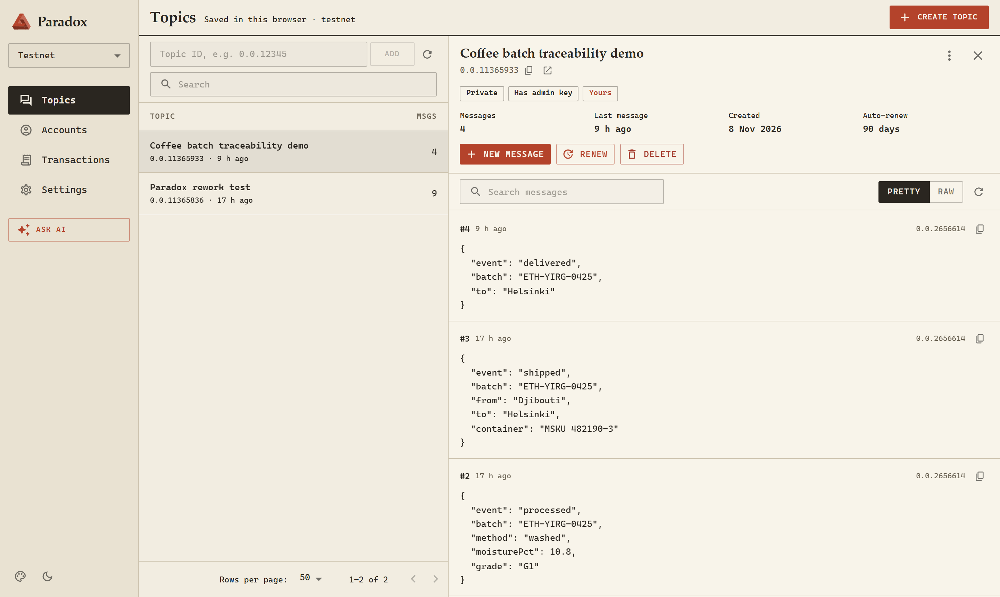
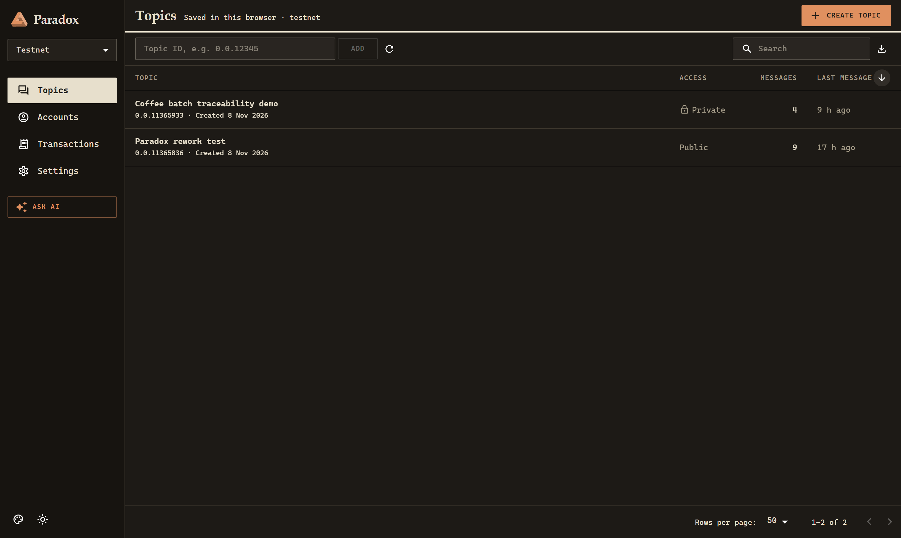
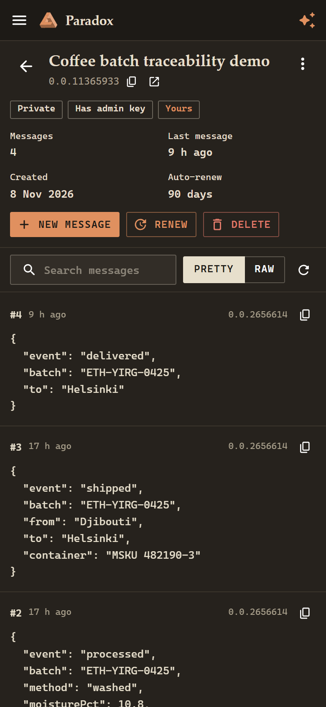
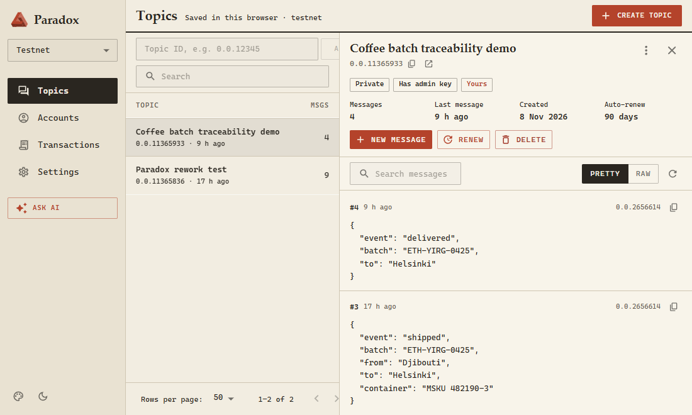
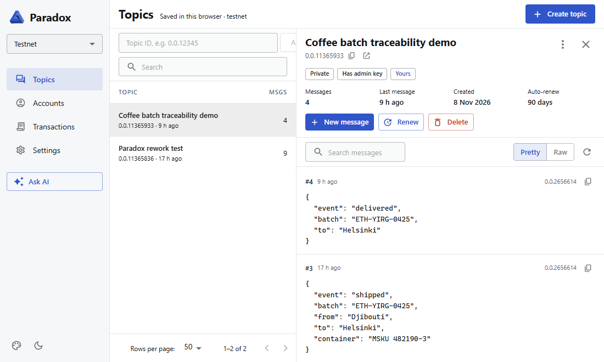
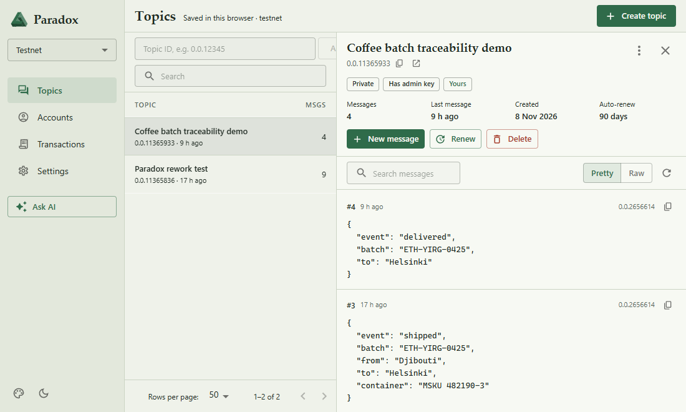
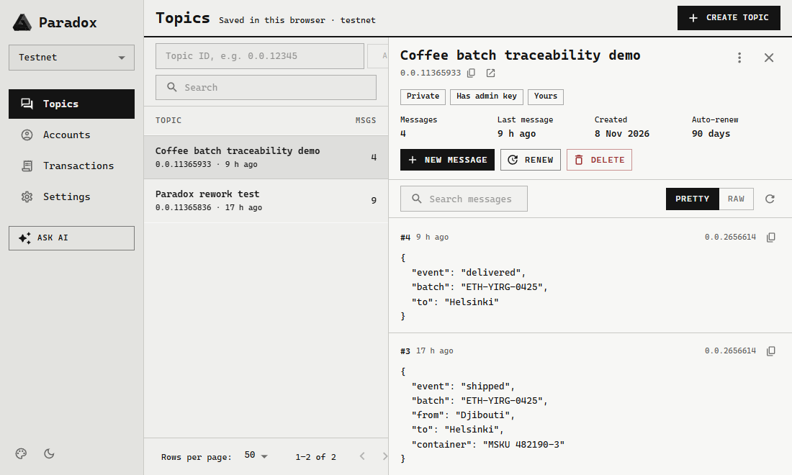

# Paradox

**A web app for the Hedera Consensus Service, with an AI assistant that acts on-chain.**

Create Hedera topics, submit and read messages, look up accounts and browse transactions. Or ask the built-in Claude assistant to do it for you. The assistant calls the official [Hedera Agent Kit](https://github.com/hashgraph/hedera-agent-kit-js) tools on the server and can use extra tools from any MCP server.

**Live demo:** https://paradoxhedera.netlify.app (Hedera testnet)



<p align="center">
  
  &nbsp;
  
</p>

## Features

- **Topics at a glance:** a list with each topic's message count and last activity, and a detail pane with the id (copy and HashScan link), access (public or private), key ownership, auto-renew and live-updating messages (refreshed every 10 s). Topics have their own URLs, such as `/topics/0.0.12345`.
- **Messages:** compose JSON, YAML, XML or text (Monaco editor on desktop, plain text on phones, with a byte counter). Messages larger than one chunk are split across up to 20 chunks and reassembled, with correct UTF-8, when read back. Search, pretty or raw view, and copy for every message.
- **Free reads, asked-for writes:** everything you read comes from the free Hedera mirror node. Anything that costs HBAR (create, renew or delete a topic, submit a message, send HBAR) first shows the network, the paying account and the typical fee, and only runs after you accept.
- **AI assistant:** chat with Claude, which reads Hedera for free and proposes paid actions as approval cards. Replies stream live, with a chip for each tool call.
- **Data grids:** topics and transactions use [MUI X Data Grid](https://mui.com/x/react-data-grid/) (MIT), with virtualized rows, sorting, search and CSV export. Only the rows scroll.
- **Accounts and transactions:** balance, staking and expiry details, and transaction history with readable types, a details dialog (every transfer, plus a HashScan link) and "load older" paging.
- **Any network, safely:** browse mainnet, testnet or previewnet read-only. Writes only happen on the network the server is configured for, which is testnet by default.
- **Themes:** four built-in themes, each in light and dark (or following the OS): Paper (matte retro), Clean, Forest and Graphite. Switch from the palette button in the sidebar or in Settings; the choice is remembered per browser.
- **Minimal, responsive design:** flat and quiet, using the full screen, from wide desktops down to 320px phones.

## Themes

Every theme has a light and a dark variant. Pick one in Settings or from the palette button in the sidebar.

| Paper | Clean |
|---|---|
|  |  |
| **Forest** | **Graphite** |
|  |  |

## Architecture

```
Browser (React 19 · MUI 9 · Vite 8)          ← holds no keys
  ├─ reads ──────────────► Hedera mirror node REST API (public)
  └─ writes / chat ──────► Netlify Functions /api/*
                             ├─ GET  /api/config          network, operator account, enabled features
                             ├─ POST /api/hedera/:action  create · submit · renew · delete topic, transfer
                             ├─ POST /api/chat            Claude tool loop, streamed as NDJSON
                             └─ POST /api/chat/execute    runs one paid chatbot action after the user accepted it
                                    └─ ToolRegistry
                                         ├─ HederaAgentKitProvider   official Hedera Agent Kit tools, in-process
                                         └─ McpToolProvider × n      any remote MCP server (Streamable HTTP)
```

### Server-side signing

The Hedera private key and the Anthropic API key exist only as server environment variables. Nothing secret is ever shipped to the browser, which needs no Hedera SDK at all. Every endpoint validates input with zod, rejects cross-origin requests, rate-limits per IP and caps request sizes. Mainnet signing is refused unless `HEDERA_ALLOW_MAINNET=true`.

### Free reads, accepted writes

The app never pays for a read: the Hedera client's query payment cap is zero and all reads go to the mirror node. Paid actions are gated in the UI by one shared prompt, and in the chatbot by approval cards: the chat loop does not run paid tools itself, it hands them to you and only `/api/chat/execute` runs them, after you accept.

### The MCP-ready chatbot

The chat loop (`netlify/lib/chat/agent.ts`) is a streaming Claude tool-use loop that only knows one small interface:

```ts
interface ToolProvider {
    id: string; // tools are exposed to Claude as `<id>__<tool>`
    listTools(): Promise<Tool[]>;
    callTool(name: string, input: unknown): Promise<string>;
    approval(name: string, input: Record<string, unknown>): { label: string; feeHbar: number | null } | null; // non-null = needs user approval
}
```

- **`HederaAgentKitProvider`** wraps a curated, non-destructive subset of the Hedera Agent Kit: topic info and messages and HBAR balance (free mirror node reads, run immediately), plus create topic and submit message (paid, run only after you accept). Tool input is validated against the kit's own zod schemas.
- **`McpToolProvider`** connects to remote MCP servers listed in `MCP_SERVERS`, so new capabilities (for example a supply-chain traceability service) plug in through configuration, without code changes. Tools an MCP server does not declare read-only need your approval too. An unreachable server is skipped; it never takes the chatbot down.

## Tech stack

React 19 · TypeScript 6 · Vite 8 · MUI 9 (Emotion) · MUI X Data Grid · react-router 8 · Netlify Functions · `@hiero-ledger/sdk` · `@hashgraph/hedera-agent-kit` · `@anthropic-ai/sdk` · `@modelcontextprotocol/sdk` · zod · ESLint 10 · Prettier

## Run it locally

Requires Node 22.12 or later and a Hedera testnet account (free at [portal.hedera.com](https://portal.hedera.com)).

```bash
git clone https://github.com/Danielevaccari/paradox.git
cd paradox
npm install
cp .env.example .env   # fill in HEDERA_ACCOUNT_ID, HEDERA_PRIVATE_KEY and optionally ANTHROPIC_API_KEY
npm run dev            # http://localhost:5173
```

`npm run dev` serves the Netlify Functions through a small Vite plugin (`vite/netlifyFunctionsDev.ts`), so you don't need `netlify-cli`. Without a backend configuration the app still runs read-only.

| Script | |
|---|---|
| `npm run dev` | Dev server with the API functions |
| `npm run lint` | ESLint (flat config) |
| `npm run typecheck` | TypeScript for the app and the functions |
| `npm run build` | Typecheck, then production build |

### Environment variables

See [`.env.example`](.env.example). All of them are server-only. Never prefix a secret with `VITE_`: Vite inlines `VITE_*` variables into the public bundle.

| Variable | Purpose |
|---|---|
| `HEDERA_NETWORK` | `testnet` (default), `previewnet` or `mainnet` |
| `HEDERA_ACCOUNT_ID`, `HEDERA_PRIVATE_KEY`, `HEDERA_KEY_TYPE` | Operator account that signs and pays |
| `HEDERA_ALLOW_MAINNET`, `HEDERA_ENABLE_TRANSFER` | Opt-in switches for real-value actions |
| `ANTHROPIC_API_KEY`, `CLAUDE_MODEL` | Enables the assistant. The model defaults to `claude-opus-5-5` |
| `MCP_SERVERS` | Extra tool servers, as JSON: `[{"id":"trace","url":"https://…/mcp","headers":{…}}]` |

## Deploy

`netlify.toml` sets up the build, the functions, Node 24 and the SPA fallback. Connect the repository in Netlify and add the environment variables above.
